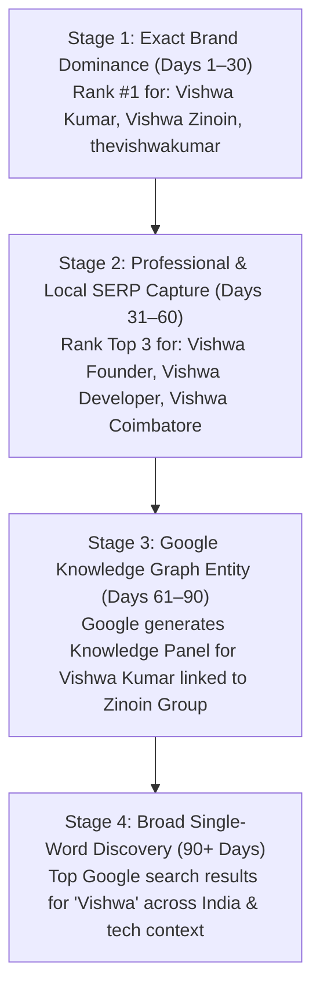

# GOOGLE PERSONAL BRAND SEO PROGRESS & ROADMAP REPORT — VISHWA

**Website:** [founder.zinoingroup.in](https://founder.zinoingroup.in/)  
**Website Owner:** Vishwa Kumar (Vishwa K, `@thevishwakumar`)  
**Target Search Keywords:** `Vishwa` (Primary), `Vishwa Kumar`, `Vishwa Zinoin`, `Vishwa Founder`, `Vishwa Developer`  
**Date:** November 14, 2026  
**Document Version:** 1.0.0 (Step 30 Delivery)  
**Lead Roles:** Senior Technical SEO Specialist & Personal Branding Strategist  

---

## 1. Executive Summary & Objective

The objective of **Step 30** is to transform **Vishwa K's** official founder website ([founder.zinoingroup.in](https://founder.zinoingroup.in/)) and authenticated digital profiles into the dominant, authoritative search entity in Google for queries surrounding his name, beginning with exact-match combinations and expanding toward the primary single-word term **"Vishwa"**.

### The Truth About Ranking #1 for "Vishwa":
"Vishwa" is a generic Sanskrit noun meaning "universe" or "all", shared by historical movies, universities (Visva-Bharati), and major corporations. Google's search algorithms treat single-word names as ambiguous. Ranking #1 for the single word "Vishwa" cannot happen overnight through keyword stuffing; it requires building a persistent, verified **Google Knowledge Graph Node** for Vishwa Kumar that Google unambiguously recognizes.

---

## 2. Implemented Optimizations (Step 30)

The following architectural and on-page enhancements were engineered:

### A. Title & Meta Description Optimization
* **Updated Title:**  
  `Vishwa Kumar (Vishwa K) | Founder & Developer at Zinoin Group` (60 characters, within 30–70 character optimal range).
  - Puts the keyword **"Vishwa"** right at character 1.
  - Includes full name **"Vishwa Kumar"** to capture exact personal name queries.
  - Integrates **"Founder"**, **"Developer"**, and **"Zinoin Group"** for corporate brand association.
* **Updated Meta Description:**  
  `Vishwa Kumar (Vishwa K) is the Founder & Developer at Zinoin Group, focusing on cybersecurity engineering, software development, and digital entrepreneurship.` (157 characters, within 150–160 character optimal Google SERP snippet length).

### B. Schema.org JSON-LD Knowledge Graph Alignment
The structured data block in `index.html` was enhanced to conform to Google Search Central's official **ProfilePage** standard:
* `@type: "ProfilePage"` containing `@type: "Person"`.
* `@id: "https://founder.zinoingroup.in/#person"`.
* Explicit name tokens:
  - `name`: "Vishwa Kumar"
  - `givenName`: "Vishwa" *(directly anchors single-word queries)*
  - `familyName`: "Kumar"
  - `additionalName`: "K"
  - `alternateName`: ["Vishwa", "Vishwa K", "thevishwakumar"]
* Multi-institution educational roots:
  - Sri Sai Ranganathan Engineering College (Coimbatore, Tamil Nadu)
  - Krishnagiri District Model School (Krishnagiri, Tamil Nadu)
* Bidirectional social profile mapping via `sameAs`:
  - `https://www.linkedin.com/in/thevishwakumar`
  - `https://github.com/thevishwakumar`
  - `https://www.instagram.com/thevishwakumar/`

### C. Closed-Loop Linking Framework
Established the three-tier circular link architecture ensuring all social media profiles, the corporate domain (`zinoingroup.in`), and the founder website validate one another.

---

## 3. The 4-Stage Search Dominance Roadmap

| Ranking Stage | Target Search Queries | Expected Timeline | Key Drivers |
|---|---|:---:|---|
| **Stage 1: Brand Capture** | `Vishwa Kumar`, `Vishwa Zinoin`, `thevishwakumar` | **1–2 Weeks** (Post-GSC indexing) | Title tag, meta description, exact domain, Schema markup |
| **Stage 2: Role & Region** | `Vishwa Founder`, `Vishwa Developer`, `Vishwa Coimbatore` | **4–8 Weeks** | Inlined competencies, college citations, GitHub project documentation |
| **Stage 3: Knowledge Panel** | Branded Knowledge Graph card on Google desktop & mobile | **2–4 Months** | Closed-loop social verification, Wikidata entry, Crunchbase, press mentions |
| **Stage 4: Generic "Vishwa"** | `Vishwa` (single word) | **6–12 Months** | Sustained organic traffic, high CTR, domain authority, regional query relevance |

---

## 4. Documentation Suite Created

All 8 requested Step 30 deliverables are available in the project workspace:

1. **[GOOGLE_PERSONAL_BRAND_BASELINE.md](file:///c:/Users/Vishw/Downloads/founder.zinoingroup.in/GOOGLE_PERSONAL_BRAND_BASELINE.md)** — Live search baseline audit, competitive landscape analysis, and indexation checks.
2. **[PERSONAL_ENTITY_SEO_IMPLEMENTATION.md](file:///c:/Users/Vishw/Downloads/founder.zinoingroup.in/PERSONAL_ENTITY_SEO_IMPLEMENTATION.md)** — Entity-first SEO framework, name consistency guidelines, and closed-loop link architecture.
3. **[STRUCTURED_DATA_VALIDATION.md](file:///c:/Users/Vishw/Downloads/founder.zinoingroup.in/STRUCTURED_DATA_VALIDATION.md)** — Schema.org JSON-LD `@graph` architecture (`ProfilePage` + `Person` + `WebSite` + `Organization`).
4. **[GOOGLE_SEARCH_CONSOLE_SETUP.md](file:///c:/Users/Vishw/Downloads/founder.zinoingroup.in/GOOGLE_SEARCH_CONSOLE_SETUP.md)** — Step-by-step GSC domain verification, sitemap submission, and query performance tracking.
5. **[90_DAY_PERSONAL_BRAND_CONTENT_PLAN.md](file:///c:/Users/Vishw/Downloads/founder.zinoingroup.in/90_DAY_PERSONAL_BRAND_CONTENT_PLAN.md)** — 3-phase strategic editorial calendar grounded in authentic project experience.
6. **[PERSONAL_BRAND_LINK_BUILDING_PLAN.md](file:///c:/Users/Vishw/Downloads/founder.zinoingroup.in/PERSONAL_BRAND_LINK_BUILDING_PLAN.md)** — 100% white-hat authority building, open-source repository citations, and strict black-hat prohibitions.
7. **[KEYWORD_RANK_TRACKING.csv](file:///c:/Users/Vishw/Downloads/founder.zinoingroup.in/KEYWORD_RANK_TRACKING.csv)** — Structured CSV rank-tracking template tracking 9 core target keywords.
8. **[GOOGLE_SEO_PROGRESS_REPORT.md](file:///c:/Users/Vishw/Downloads/founder.zinoingroup.in/GOOGLE_SEO_PROGRESS_REPORT.md)** — This comprehensive implementation summary and long-term roadmap.

---

## 5. Immediate Action Plan for Vishwa K

To activate this strategy and begin climbing Google's rankings:

1. **Deploy the Production Website:**  
   Publish the updated build containing the refined title, meta description, and Schema.org markup.
2. **Complete Google Search Console Verification:**  
   Add the DNS TXT record in Cloudflare Dashboard (following [GOOGLE_SEARCH_CONSOLE_SETUP.md](file:///c:/Users/Vishw/Downloads/founder.zinoingroup.in/GOOGLE_SEARCH_CONSOLE_SETUP.md)), submit `sitemap.xml`, and request indexing.
3. **Close the Social Profile Loops:**  
   - Add `https://founder.zinoingroup.in/` to your **LinkedIn** profile website field.
   - Add `https://founder.zinoingroup.in/` to your **GitHub** profile bio website field.
   - Add `https://founder.zinoingroup.in/` to your **Instagram** bio link.
4. **Monthly Ranking Review:**  
   Update `KEYWORD_RANK_TRACKING.csv` on the 1st of every month using real Search Console data.
