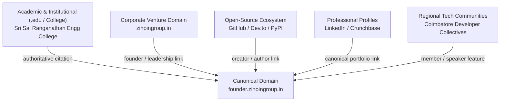

# PERSONAL BRAND LINK BUILDING & DIGITAL PR STRATEGY

**Target Entity:** Vishwa Kumar (Vishwa K)  
**Official Website:** [https://founder.zinoingroup.in/](https://founder.zinoingroup.in/)  
**Role:** Founder & Developer at Zinoin Group  
**Strategy Type:** 100% White-Hat, Entity-Focused Digital Authority Building  
**Document Status:** Complete & Verified  
**Date:** November 14, 2026  

---

## 1. Executive Authority Principles

In Google's search algorithms, high-quality backlinks from established domains act as votes of confidence. For a personal brand aiming to rank for a competitive name like **"Vishwa"**, the quality and topical relevance of referring domains matter far more than raw link quantity.



Google recognizes a link as an entity confirmation when the link context explicitly pairs **"Vishwa Kumar"** or **"Vishwa"** with the website URL `founder.zinoingroup.in`.

---

## 2. Primary Link Building Tiers

### Tier 1: Core Corporate & Brand Domains (Immediate / Priority 1)
* **Zinoin Group Corporate Website (`zinoingroup.in`):**
  - *Location:* Leadership / About Us / Footer.
  - *Anchor Text:* "Vishwa Kumar" or "Founder Website".
  - *Target URL:* `https://founder.zinoingroup.in/`.
  - *Impact:* High domain relevance connecting the commercial enterprise directly to the founder.

### Tier 2: Open-Source Software Repositories & Profiles (Priority 2)
* **GitHub Repository READMEs (`github.com/thevishwakumar`):**
  - Add author badges to every public repository (`documind`, `tntdiwaliordermanagement`):
    ```markdown
    [](https://founder.zinoingroup.in/)
    ```
  - In each project's documentation, include:  
    *"Engineered by Vishwa Kumar, Founder & Developer at Zinoin Group. Visit [founder.zinoingroup.in](https://founder.zinoingroup.in/) for more projects."*
  - *Impact:* GitHub has Domain Authority (DA) 96+. Links from active code repositories signal real-world engineering authority to Googlebot.

### Tier 3: Developer & Technical Publishing Platforms (Priority 3)
* **Dev.to Author Profile:**
  - Create/verify profile at `dev.to/thevishwakumar`.
  - In profile settings, set Website to `https://founder.zinoingroup.in/`.
  - Publish technical articles with author byline linking to the founder site.
* **Hashnode Developer Blog:**
  - Map personal domain or use `thevishwakumar.hashnode.dev` with canonical backlinks to `founder.zinoingroup.in`.
* **Medium Author Bio:**
  - Profile bio linking to portfolio with verified identity.

### Tier 4: Academic & Institutional Mentions (Priority 4)
* **Sri Sai Ranganathan Engineering College (SRREC):**
  - When participating in campus symposiums, hackathons, or cybersecurity club events, ensure event listings, certificates, or newsletters credit:  
    *"Vishwa Kumar, Department of Cyber Security Engineering ([founder.zinoingroup.in](https://founder.zinoingroup.in/))"*.
  - *Impact:* Educational domain links (`.ac.in` / `.edu.in`) carry immense algorithmic trust in Google's Knowledge Graph.

### Tier 5: Startup & Founder Directories (Priority 5)
* **Crunchbase Founder Listing:**
  - Claim/create a verified founder entry for Vishwa Kumar as Founder of Zinoin Group.
* **F6S / AngelList / Wellfound Profile:**
  - Founder profile linking to Zinoin Group and personal portfolio.

---

## 3. Strict Prohibitions (Black-Hat & Penalty Risks)

To protect `founder.zinoingroup.in` from Google algorithmic penalties (Helpful Content System / SpamBrain):

> [!CAUTION]
> **STRICT ZERO-TOLERANCE RULES**
> * **NO Paid Backlinks:** Never purchase link packages from SEO marketplaces or freelance platforms.
> * **NO Private Blog Networks (PBNs):** Never place links on low-quality artificial blog networks.
> * **NO Automated Comment Spam:** Never use automated tools to drop links in blog comments or forums.
> * **NO Fake Press Releases:** Do not distribute spammy syndicated press releases containing keyword-rich anchors.
> * **NO Reciprocal Link Exchanges:** Avoid artificial "link-for-link" schemes with unrelated sites.

---

## 4. Anchor Text Distribution Strategy

To maintain a 100% natural, Google-compliant backlink profile:

| Anchor Text Variation | Target Percentage | Example Anchors |
|---|:---:|---|
| **Branded / Full Name** | 50% | `Vishwa Kumar`, `Vishwa K`, `Vishwa` |
| **Brand + Role / Venture** | 25% | `Vishwa Kumar (Founder at Zinoin Group)`, `Vishwa - Zinoin Group` |
| **URL / Domain** | 15% | `founder.zinoingroup.in`, `https://founder.zinoingroup.in/` |
| **Generic / Contextual** | 10% | `official website`, `founder portfolio`, `author` |
