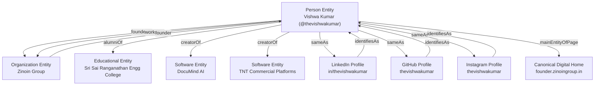

# PERSONAL BRAND ENTITY SEO IMPLEMENTATION — VISHWA

**Target Entity:** Vishwa Kumar (Vishwa K)  
**Primary Brand Handle:** `@thevishwakumar`  
**Official Canonical Domain:** [https://founder.zinoingroup.in/](https://founder.zinoingroup.in/)  
**Corporate Entity:** Zinoin Group ([https://zinoingroup.in/](https://zinoingroup.in/))  
**Auditor:** Senior Technical SEO Specialist & Entity Strategist  
**Date:** November 14, 2026  

---

## 1. Principles of Entity-First SEO: "Things, Not Strings"

Traditional SEO focused on repeating a keyword across a webpage. Modern Google Search operates on the **Google Knowledge Graph**, an interconnected neural database of **entities** (real-world people, organizations, places, and works) and the **relationships** between them.

When someone searches for **"Vishwa"**, Google evaluates:
1. *Is there an authoritative person named Vishwa who matches the searcher's geographical, professional, or social context?*
2. *Can Google verify that this person is real, notable, and uniquely identified across multiple independent sources?*
3. *What is the authoritative primary source of truth for this person?*

Our entity strategy makes `founder.zinoingroup.in` the **unquestioned primary source of truth** for Vishwa Kumar.

---

## 2. Personal Entity vs. Corporate Entity Distinction

Google penalizes ambiguity where an individual and a company are conflated into a single messy entity. We enforce strict semantic separation:

| Attribute | Personal Entity: Vishwa Kumar | Corporate Entity: Zinoin Group |
|---|---|---|
| **Schema.org Type** | `Person` | `Organization` |
| **Canonical URL** | `https://founder.zinoingroup.in/` | `https://zinoingroup.in/` |
| **Primary Identifier** | `@id: "https://founder.zinoingroup.in/#person"` | `@id: "https://zinoingroup.in/#organization"` |
| **Role & Function** | Founder, Software Developer, Cybersecurity Explorer | Enterprise Technology Services & Infrastructure |
| **Associated Profiles** | Personal LinkedIn, Personal GitHub, Personal Instagram | Company LinkedIn Page, Corporate Twitter/X, Official Domain |
| **Relationship** | `founder`, `worksFor` | `founder: Vishwa Kumar` |

---

## 3. Name Disambiguation & Consistency Standard

To help Google distinguish Vishwa from the millions of search occurrences of the common name:

### Standardized Name Formula:
* **Primary Public Brand Name:** **Vishwa Kumar (Vishwa K)**
* **Short Display Name:** **Vishwa K** (for concise UI badges and headers)
* **Full Legal / Academic Name:** **Vishwa Kumar** (for SERP title tags, Schema markup, and external citations)
* **Unified Social Handle:** **`thevishwakumar`** across all platforms

### Why this works:
1. "Vishwa" alone has hundreds of thousands of competing web pages.
2. "Vishwa Kumar" immediately filters out 90% of unrelated entities (movies, dictionary terms, organizations).
3. "Vishwa Kumar" paired with "Zinoin Group", "Cybersecurity", "Sri Sai Ranganathan Engineering College", and "@thevishwakumar" creates a **100% unique entity fingerprint** in Google's Knowledge Graph.

---

## 4. Closed-Loop Linking Architecture

Google establishes entity trust when external authoritative sources point to a website, and the website points back with exact bidirectional symmetry. We call this the **Closed-Loop Verification Circle**:

### Loop 1: Website ➔ Social Profiles (Outbound Trust)
In `founder.zinoingroup.in`:
* JSON-LD `sameAs` array explicitly points to:
  - `https://www.linkedin.com/in/thevishwakumar`
  - `https://github.com/thevishwakumar`
  - `https://www.instagram.com/thevishwakumar/`
* Navigation, hero, contact, and footer sections render verified outbound links with `rel="noopener noreferrer"`.

### Loop 2: Social Profiles ➔ Website (Inbound Authority)
The owner must configure the following exact URLs in each profile:
* **LinkedIn:** In the profile "Contact Info" section and profile top card:  
  *Website:* `https://founder.zinoingroup.in/` (Type: Portfolio)
* **GitHub:** In profile settings (`https://github.com/settings/profile`):  
  *Name:* Vishwa Kumar  
  *Bio:* Founder & Developer at Zinoin Group. Cybersecurity Engineering student.  
  *Website:* `https://founder.zinoingroup.in/`
* **Instagram:** In edit profile (`@thevishwakumar`):  
  *Bio:* Founder @zinoingroup · Tech & Cybersecurity  
  *Link:* `https://founder.zinoingroup.in/`

### Loop 3: Corporate Domain ➔ Founder Domain
On `https://zinoingroup.in/` (Corporate website):
* In the About / Leadership section or footer:  
  *"Founded by Vishwa Kumar ([founder.zinoingroup.in](https://founder.zinoingroup.in/))"*
* In corporate Schema.org:  
  `"founder": {"@type": "Person", "name": "Vishwa Kumar", "url": "https://founder.zinoingroup.in/"}`

---

## 5. Google Knowledge Graph Triggers

To accelerate Google's formation of an official **Knowledge Panel** for Vishwa Kumar:

1. **Structured Data Implementation:** Conforming to Schema.org `ProfilePage` and `Person` guidelines (implemented in Section 3).
2. **Wikidata Entity Entry (Free & High Authority):** Create an authoritative Wikidata entry for `Vishwa Kumar (Indian entrepreneur and software developer)` linked to `founder.zinoingroup.in`, his GitHub, and his LinkedIn.
3. **Crunchbase Profile:** Create an authenticated founder profile on Crunchbase for Vishwa Kumar linked to Zinoin Group.
4. **Consistency Across Author Bylaws:** Whenever writing articles on Dev.to, Medium, or LinkedIn, always use the author signature:  
   *"Vishwa Kumar is the Founder & Developer at Zinoin Group and a cybersecurity engineering student at Sri Sai Ranganathan Engineering College."*
